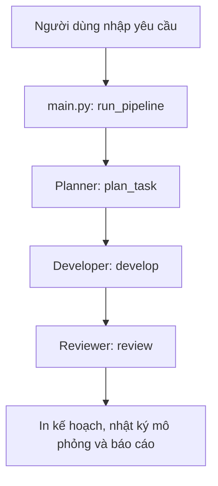

# Kiến trúc 3-Agent Python (MVP offline)

## Luồng xử lý

## Trách nhiệm
| Thành phần | Đầu vào | Đầu ra | Hiện trạng |
|---|---|---|---|
| `planner.py` | Chuỗi yêu cầu | 3 bước kế hoạch | Quy tắc cố định |
| `developer.py` | Danh sách bước | Nhật ký trạng thái `simulated` | Không tạo hoặc sửa code |
| `reviewer.py` | Kế hoạch và nhật ký | `passed`, `checked`, `mode` | Kiểm tra cấu trúc, không đánh giá chất lượng code |
| `main.py` | Yêu cầu từ CLI | Báo cáo toàn bộ quy trình | Điều phối tuần tự |

## Ranh giới an toàn
- Không gọi API LLM, không chạy shell từ đầu vào người dùng, không chỉnh sửa dự án ngoài.
- `passed: True` chỉ biểu thị nhật ký mô phỏng phù hợp kế hoạch, **không** chứng minh game đã được tạo.
- Hướng nâng cấp: LLM lập kế hoạch → công cụ tạo bản vá trong thư mục cho phép → kiểm thử tự động → người dùng phê duyệt trước khi áp dụng.
