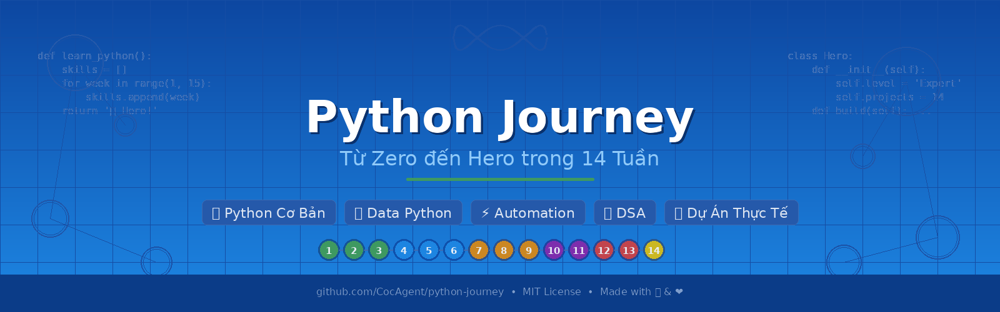

# 🐍 Python Journey — Weekly Roadmap

<p align="center">
  
</p>

<p align="center">
  <strong>Học Python bằng cách viết code, chạy thử, kiểm tra và tự sửa lỗi.</strong>
</p>

<p align="center">
  
  
  
</p>

> Đây là trang tổng hợp các tuần học trong **Python Journey**. Mỗi tuần nên được học theo vòng lặp:  
> **Đọc README → xem ví dụ → tự viết code → chạy chương trình → kiểm tra kết quả → sửa lỗi → ghi lại điều đã học.**

- 🏠 [README chính của dự án](../README.md)
- 🧰 [Hướng dẫn cài đặt môi trường](../SETUP.md)
- 📚 [Đề cương 15 tuần](../SYLLABUS.md)
- ✅ [Theo dõi tiến độ học](../PROGRESS.md)
- 🎓 [Yêu cầu đồ án cuối khóa](../FINAL_PROJECT.md)

---

## 🗺️ Lộ trình 15 tuần

| Tuần | Chủ đề | Mục tiêu thực hành |
|---|---|---|
| 01 | Làm quen Python, terminal, Git/GitHub | Chạy chương trình đầu tiên và commit code |
| 02 | Biến, kiểu dữ liệu, nhập/xuất | Nhận dữ liệu và xử lý giá trị |
| 03 | Điều kiện và kiểm tra đầu vào | Viết logic `if/elif/else` an toàn |
| 04 | Chuỗi và xử lý văn bản | Phân tích, làm sạch chuỗi |
| 05 | List, tuple và dữ liệu tuần tự | Lưu trữ, truy cập, cập nhật dữ liệu |
| 06 | Vòng lặp và comprehension | Lặp qua dữ liệu rõ ràng, đúng mục đích |
| 07 | Hàm và type hints | Chia chương trình thành các hàm nhỏ |
| 08 | Dictionary, set và dữ liệu lồng nhau | Đếm, tra cứu và tổ chức dữ liệu |
| 09 | Midterm project | Kết hợp kiến thức tuần 01–08 |
| 10 | File, pathlib, CSV, JSON | Đọc và lưu dữ liệu |
| 11 | Exceptions và debugging | Đọc traceback và xử lý lỗi phù hợp |
| 12 | Testing với pytest | Kiểm thử trường hợp thường, biên và lỗi |
| 13 | Module, package, CLI và API | Tổ chức chương trình thành nhiều phần |
| 14 | OOP, composition và inheritance | Xây dựng class khi mô hình hóa có ích |
| 15 | Capstone project | Hoàn thiện chương trình có code, test và hướng dẫn |

> Tên thư mục và nội dung cụ thể của từng tuần được thể hiện trong danh sách file của repository. Hãy mở thư mục tuần tương ứng và đọc README của tuần đó trước khi bắt đầu.

---

## 🚀 Cách chạy code Python

### 1. Chuẩn bị

Cần có:
- **Python 3.12 trở lên** (nếu bài học yêu cầu phiên bản khác, ưu tiên README của bài).
- Một trình soạn thảo như [Visual Studio Code](https://code.visualstudio.com/).
- Terminal: Windows PowerShell, Command Prompt, hoặc terminal của macOS/Linux.

Kiểm tra Python đã được cài chưa:

**Windows**
```powershell
py --version
```

Nếu lệnh trên không chạy, thử:
```powershell
python --version
```

**macOS / Linux**
```bash
python3 --version
```

Nếu chưa có Python, tải từ [python.org/downloads](https://www.python.org/downloads/). Trên Windows, khi cài đặt hãy bật tùy chọn **Add Python to PATH** nếu trình cài đặt cung cấp tùy chọn đó.

### 2. Tải repository về máy

Nếu đã cài Git:

```bash
git clone https://github.com/LeTriDung-A/python-journey-123.git
cd python-journey-123
```

Nếu không dùng Git, vào trang repository, bấm **Code → Download ZIP**, giải nén rồi mở thư mục đã giải nén bằng VS Code.

### 3. Mở đúng thư mục bài học

Trong VS Code, chọn **File → Open Folder** và mở thư mục repository. Sau đó mở thư mục `weeks`, chọn tuần cần học, rồi tìm file Python có đuôi `.py`.

Ví dụ cấu trúc:
```text
python-journey-123/
├── README.md
├── weeks/
│   ├── week-01-.../
│   ├── week-02-.../
│   └── ...
└── tests/
```

Tên thư mục ví dụ ở trên chỉ minh họa cấu trúc; hãy dùng tên thư mục thực tế đang có trong repository.

### 4. Chạy một file

Mở terminal tại thư mục chứa file Python rồi chạy:

**Windows**
```powershell
py ex01_example.py
```

Hoặc:
```powershell
python ex01_example.py
```

**macOS / Linux**
```bash
python3 ex01_example.py
```

Thay `ex01_example.py` bằng **tên file thực tế**. Nếu file nằm trong thư mục khác, hãy `cd` vào thư mục đó trước khi chạy.

Ví dụ:
```powershell
cd weeks
cd week-14-oop-essentials
py ex01_classes.py
```

Lệnh ví dụ trên áp dụng khi thư mục tuần 14 có tên `week-14-oop-essentials` và chứa file `ex01_classes.py`. Nếu tên khác, hãy sửa lệnh cho khớp với repository.

### 5. Nếu bài dùng thư viện ngoài

Đọc README của tuần để xem bài có yêu cầu cài thư viện hay không. Nếu có file `requirements.txt`, có thể tạo môi trường ảo tại thư mục dự án:

```powershell
# Windows
py -m venv .venv
.venv\Scripts\Activate.ps1
python -m pip install -r requirements.txt
```

```bash
# macOS / Linux
python3 -m venv .venv
source .venv/bin/activate
python -m pip install -r requirements.txt
```

Không cần cài thêm thư viện nếu bài chỉ dùng thư viện có sẵn trong Python.

### 6. Chạy kiểm thử (nếu bài có test)

Nếu dự án hoặc tuần học sử dụng `pytest`:

```bash
python -m pip install pytest
python -m pytest
```

Muốn chạy một file test cụ thể:
```bash
python -m pytest tests/test_example.py -v
```

Chạy lệnh tại đúng thư mục dự án hoặc theo hướng dẫn riêng của tuần. Nếu chưa có test, không cần chạy lệnh pytest.

---

## 🧠 Cách học mỗi tuần hiệu quả

1. **Đọc mục tiêu**: hiểu cuối buổi mình cần làm được gì.
2. **Đọc ví dụ**: tự giải thích từng dòng trước khi chạy.
3. **Tự gõ lại code**: hạn chế chỉ sao chép rồi chạy.
4. **Thử thay đổi đầu vào**: kiểm tra số 0, chuỗi rỗng, dữ liệu sai và trường hợp biên.
5. **Đọc lỗi**: bắt đầu từ dòng cuối của traceback rồi lần theo file và dòng được nhắc đến.
6. **Làm bài tập trước khi xem lời giải**.
7. **Ghi chú ngắn**: nêu khái niệm, lỗi từng gặp và cách sửa.
8. **Commit thay đổi**: đặt thông điệp commit mô tả đúng việc đã làm.

### Checklist trước khi kết thúc tuần

- [ ] Tôi có thể giải thích mục tiêu chính của tuần.
- [ ] Tôi đã tự viết và chạy các bài tập.
- [ ] Tôi đã thử ít nhất một trường hợp biên hoặc đầu vào không hợp lệ.
- [ ] Tôi hiểu lỗi mình gặp và cách sửa.
- [ ] Tôi đã hoàn thành thử thách/mini-project nếu có.
- [ ] Tôi đã lưu thay đổi bằng Git hoặc tải code lên GitHub.

---

## 🧩 Lỗi thường gặp

| Hiện tượng | Cách xử lý |
|---|---|
| `python` hoặc `py` không được nhận diện | Kiểm tra cài đặt Python và PATH; thử `py --version` hoặc `python3 --version` |
| `can't open file` | Kiểm tra tên file, phần mở rộng `.py` và thư mục terminal hiện tại |
| `ModuleNotFoundError` | Kiểm tra đã kích hoạt đúng môi trường ảo và cài thư viện cần thiết chưa |
| Chương trình không in kết quả | Kiểm tra có gọi hàm hay có câu lệnh `print()` phù hợp không |
| `IndentationError` | Kiểm tra thụt lề; dùng thống nhất spaces, thường là 4 dấu cách |
| Test không tìm thấy | Chạy từ thư mục dự án và kiểm tra tên file/hàm test theo hướng dẫn |

---

## ✨ Làm GitHub đẹp và dễ đọc

README dùng Markdown nên có thể trang trí mà không cần HTML phức tạp:

- **Tiêu đề** bằng `#`, `##`, `###` để tạo bố cục.
- **Bảng** để tóm tắt lộ trình và mục tiêu.
- **Checklist** bằng `- [ ]` để theo dõi tiến độ.
- **Badge** từ [Shields.io](https://shields.io/) để thể hiện ngôn ngữ, trạng thái hoặc phiên bản.
- **Ảnh banner** đặt trong thư mục `assets/` và liên kết bằng đường dẫn tương đối như `../assets/banner.png`.
- **Mục lục** bằng liên kết đến các tiêu đề để người đọc di chuyển nhanh.
- **Ảnh chụp màn hình** chỉ nên thêm khi giúp giải thích kết quả chạy hoặc giao diện.

### Nguyên tắc để repository trông chuyên nghiệp

- Dùng một phong cách badge thống nhất, không đặt quá nhiều badge chỉ để trang trí.
- Tên file/thư mục ngắn gọn, dễ hiểu và thống nhất.
- Mỗi thư mục tuần nên có README nêu mục tiêu, kiến thức, cách chạy, bài tập và kết quả mong đợi.
- Đưa lệnh chạy thực tế vào README; không ghi rằng code đã kiểm thử nếu chưa chạy.
- Giữ ví dụ ngắn, code block đúng ngôn ngữ và link tương đối để điều hướng trong repository.
- Không đưa mật khẩu, API key, token hoặc dữ liệu cá nhân lên GitHub.

---

## 🌱 Quy trình lưu bài lên GitHub

Nếu repository đã được clone về máy:

```bash
git status
git add .
git commit -m "docs: improve weekly learning guide"
git push
```

Nếu đang làm trên một nhánh riêng, trước khi push hãy kiểm tra nhánh hiện tại:

```bash
git branch --show-current
```

Nếu bạn chưa có quyền ghi vào repository hoặc nhánh chính bị bảo vệ, hãy push lên nhánh riêng và mở Pull Request thay vì cố ghi trực tiếp vào nhánh chính.

---

<p align="center">
  <strong>Learn → Build → Test → Debug → Improve → Commit</strong>
  <br>
  <sub>Học chậm mà chắc; quan trọng nhất là hiểu code mình viết.</sub>
</p>
